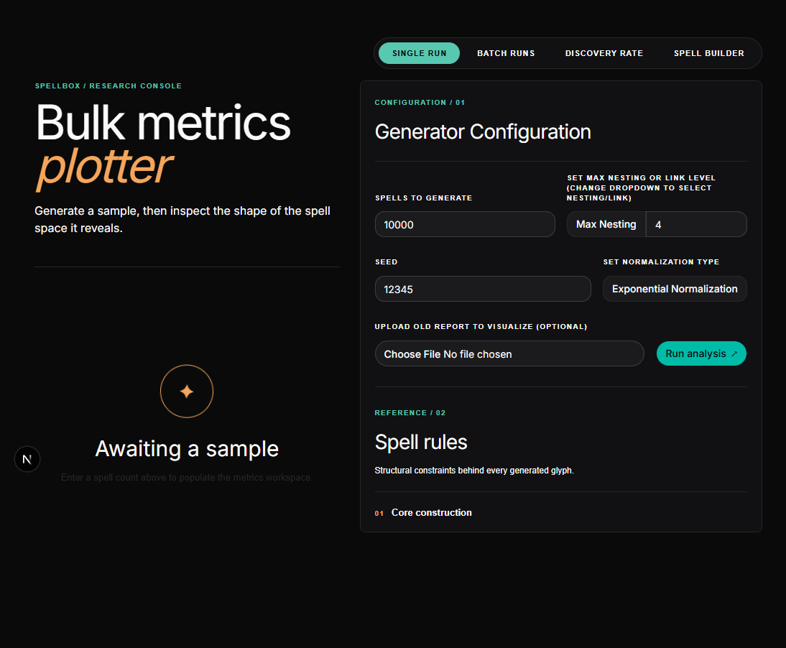
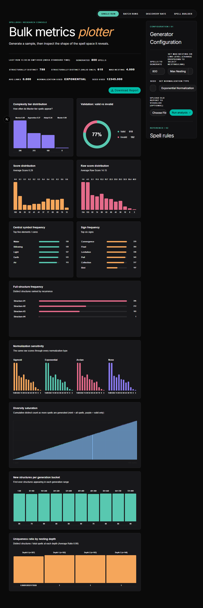

# Spell Sandbox

<p align="center">
  
</p>

<p align="center">
  <strong>Build magical systems. Measure their complexity. Explore the spell space.</strong>
</p>

A dark-luxe research playground for designing, validating, comparing, and studying magical spell systems as structured, composable objects.

Spell Sandbox is part spellcraft lab, part generative grammar engine, and part research dashboard. It asks a simple but powerful question: what happens when a small set of magical primitives is combined under a rule system and pushed far enough to reveal complexity, novelty, and convergence?

This repo turns magic design into data: sigils, signs, nested glyphs, link structures, and validation outcomes become objects you can generate, inspect, compare, and analyze.

## Why this repo exists

The project sits at the intersection of:

- generative spell design
- rule-driven composition systems
- structural validation and integrity checks
- complexity and behavior metrics
- interactive visualization and analysis

The goal is not simply to make magical-looking glyphs. It is to study how a compact grammar of components can lead to a rich, surprising, and sometimes convergent expressive space.

It is inspired by fantasy magic systems that reward creativity and composition, but it is intentionally a general-purpose sandbox rather than a direct copy of any one canon.

## What it does

### Build spells
Create spell structures from elemental sigils, control signs, manifestation signs, transformation marks, and nested composition rules.

### Validate structure
Check whether a glyph is complete, coherent, and internally valid before it is measured or compared.

### Measure complexity
Analyze the generated spell space with metrics for depth, diversity, similarity, normalization, and structural validity.

### Explore the system
Sweep generation parameters, inspect the resulting metrics, and learn how small changes alter the emergent behavior of the spell grammar.

## App preview

<div align="center">
  
</div>

<p align="center">
  <em>Real UI: generate a sample, compute metrics, and surface the shape of the spell space.</em>
</p>

## Highlights

### Research dashboard
The web app in [apps/web](apps/web) gives you a live interface for exploring the spell space with:

- bulk generation of spell variants
- complexity and similarity metrics
- structural validation and warnings
- nested glyph and link analysis
- parameter sweeps for nesting depth, links, and normalization

### Spell engine
The core logic in [packages/spellbox-cli](packages/spellbox-cli) handles:

- random spell generation
- validation of spell JSON files
- comparison of two spell structures
- behavioral and structural description of a spell

### Research and rule docs
The design language and theory behind the system live in [docs](docs):

- [docs/plan.md](docs/plan.md) — research goals and working hypothesis
- [docs/rules.md](docs/rules.md) — spell construction rules
- [docs/rune-chain-rules.md](docs/rune-chain-rules.md) — advanced composition notes
- [docs/reports](docs/reports) — analyses, plots, and generated findings

### Asset library
The magical language is grounded in visual glyphs and sigils from [Assets](Assets):

- [Assets/Sigils](Assets/Sigils) — elemental core symbols
- [Assets/Signs](Assets/Signs) — control, manifestation, transformation, and composition marks

## The core idea

Spells are represented as structured objects built from a compact grammar:

- central symbols: sigils or transformation-based cores
- surrounding signs: control, manifestation, transformation, and composition marks
- nested glyphs: layered effects and embedded complexity
- linked spells: simultaneous activation across multiple glyphs
- ring structure: the boundary that makes a spell complete and active

This representation turns spellcraft into a formal system that can be:

- generated
- validated
- compared
- scored
- iterated on systematically

## What the project measures

Generated spells are scored across multiple axes, including:

- sign counts and category composition
- nesting depth and linked-branch complexity
- structural validity and warning conditions
- normalization-sensitive complexity tiers
- similarity comparisons across effect dimensions
- convergence and diversity over large generation runs

## UI gallery

<p align="center">
  
  
</p>

<p align="center">
  <em>Two real screenshots from the app itself: the generator controls and the post-run analysis view.</em>
</p>

## Repo layout

```text
Spell-Sandbox/
├── apps/
│   └── web/                 # interactive spell dashboard and metrics viewer
├── Assets/                  # sigils and signs for the magical grammar
├── docs/                    # rules, research docs, and generated plots
├── packages/
│   └── spellbox-cli/        # spell generation and validation engine
├── test_files/              # example spell JSON and analysis artifacts
├── package.json             # npm workspace root
├── README.md                # this file
├── .gitignore
└── node_modules/
```

## Quick start

### Install dependencies

```bash
npm install
```

### Run the web dashboard

```bash
cd apps/web
npm run dev
```

Then open:

```text
http://localhost:3000
```

### Run the CLI spell engine

```bash
cd packages/spellbox-cli
npm run start
```

You can also run the bundled scripts:

```bash
npm run test
npm run plot
```

## Example workflows

### Generate and inspect a spell
Use the CLI to generate, validate, or compare spell structures from JSON files.

### Explore the metric space
Use the dashboard to generate large spell pools and inspect how complexity, validity, and diversity shift with different constraints.

### Study rule families
Tune nesting depth, link complexity, and normalization behavior to see how the spell system expands or converges.

## Why it’s compelling

At a glance, the project is pure fantasy flavor. Under the hood, though, it is a real experiment in symbolic combinatorics and emergent complexity.

It asks a deceptively simple question:

How much expressive range can be created from a compact set of rules?

That makes Spell Sandbox both:

- a creative tool for designing magical systems
- a serious sandbox for studying complexity and novelty

## Future directions

The project is already pointing toward several interesting expansions:

- richer environmental interaction rules
- world-state propagation and spell persistence
- procedural NPC spell generation
- deeper analysis of convergence and diversity
- richer spell editor workflows and simulation tools

## Contributing

This is a collaborative research sandbox, so contributions that deepen the system are welcome:

- new sign types or rule layers
- better validation logic
- richer metrics and visualizations
- cleaner spell JSON schemas
- documentation and examples

## Final note

Spell Sandbox is built for curiosity.

It turns a fantasy premise into a structured, testable system: a magic grammar, a generator, a validator, a metrics engine, and a visual playground for seeing what emerges when the system grows.

If you are here to play with spellcraft, generative design, or symbolic complexity, you are in the right place.

The project sits at the intersection of:

- generative spell design
- rule-driven composition systems
- structural validation and integrity checks
- complexity and behavior metrics
- interactive visualization and analysis

The goal is not simply to create magical-looking spell glyphs. It is to study how a compact grammar of components can lead to a rich and often surprising expressive space.

It is inspired by fantasy magic systems that reward creativity and composition, but it is intentionally a general-purpose sandbox rather than a direct copy of any one setting.

## Highlights

### Research dashboard
The web app in [apps/web](apps/web) gives you a live interface for exploring the spell space with:

- bulk generation of spell variants
- complexity and similarity metrics
- structural validation and warnings
- nested glyph and link analysis
- parameter sweeps for nesting depth, links, and normalization

### Spell engine
The core logic in [packages/spellbox-cli](packages/spellbox-cli) handles:

- random spell generation
- validation of spell JSON files
- comparison of two spell structures
- behavioral and structural description of a spell

### Research and rule docs
The design language and theory behind the system live in [docs](docs):

- [docs/plan.md](docs/plan.md) — research goals and working hypothesis
- [docs/rules.md](docs/rules.md) — spell construction rules
- [docs/rune-chain-rules.md](docs/rune-chain-rules.md) — advanced composition notes
- [docs/reports](docs/reports) — analyses, plots, and generated findings

### Asset library
The magical language is grounded in visual glyphs and sigils from [Assets](Assets):

- [Assets/Sigils](Assets/Sigils) — elemental core symbols
- [Assets/Signs](Assets/Signs) — control, manifestation, transformation, and composition marks

## The core idea

Spells are represented as structured objects built from a compact grammar:

- central symbols: sigils or transformation-based cores
- surrounding signs: control, manifestation, transformation, and composition marks
- nested glyphs: layered effects and embedded complexity
- linked spells: simultaneous activation across multiple glyphs
- ring structure: the boundary that makes a spell complete and active

This representation turns spellcraft into a formal system that can be:

- generated
- validated
- compared
- scored
- iterated on systematically

## What the project measures

Generated spells are scored across multiple axes, including:

- sign counts and category composition
- nesting depth and linked-branch complexity
- structural validity and warning conditions
- normalization-sensitive complexity tiers
- similarity comparisons across effect dimensions
- convergence and diversity over large generation runs

## UI gallery

<p align="center">
  
  
</p>

<p align="center">
  <em>Two real screenshots from the app itself: the generator controls and the post-run analysis view.</em>
</p>

## Repo layout

```text
Spell-Sandbox/
├── apps/
│   └── web/                 # interactive spell dashboard and metrics viewer
├── Assets/                  # sigils and signs for the magical grammar
├── docs/                    # rules, research docs, and generated plots
├── packages/
│   └── spellbox-cli/        # spell generation and validation engine
├── test_files/              # example spell JSON and analysis artifacts
├── package.json             # npm workspace root
├── README.md                # this file
├── .gitignore
└── node_modules/
```

## Quick start

### Install dependencies

```bash
npm install
```

### Run the web dashboard

```bash
cd apps/web
npm run dev
```

Then open:

```text
http://localhost:3000
```

### Run the CLI spell engine

```bash
cd packages/spellbox-cli
npm run start
```

You can also run the bundled scripts:

```bash
npm run test
npm run plot
```

## Example workflows

### Generate and inspect a spell
Use the CLI to generate, validate, or compare spell structures from JSON files.

### Explore the metric space
Use the dashboard to generate large spell pools and inspect how complexity, validity, and diversity shift with different constraints.

### Study rule families
Tune nesting depth, link complexity, and normalization behavior to see how the spell system expands or converges.

## Why it’s compelling

At a glance, the project is pure fantasy flavor. Under the hood, though, it is a real experiment in symbolic combinatorics and emergent complexity.

It asks a deceptively simple question:

How much expressive range can be created from a compact set of rules?

That makes Spell Sandbox both:

- a creative tool for designing magical systems
- a serious sandbox for studying complexity and novelty

## Future directions

The project is already pointing toward several interesting expansions:

- richer environmental interaction rules
- world-state propagation and spell persistence
- procedural NPC spell generation
- deeper analysis of convergence and diversity
- richer spell editor workflows and simulation tools

## Contributing

This is a collaborative research sandbox, so contributions that deepen the system are welcome:

- new sign types or rule layers
- better validation logic
- richer metrics and visualizations
- cleaner spell JSON schemas
- documentation and examples

## Final note

Spell Sandbox is built for curiosity.

It turns a fantasy premise into a structured, testable system: a magic grammar, a generator, a validator, a metrics engine, and a visual playground for seeing what emerges when the system grows.

If you are here to play with spellcraft, generative design, or symbolic complexity, you are in the right place.
