# Compiled Analysis

This is a cumulative report derived from the experiments performed according to the [plan](../plan.md).

**Why this file exists, and how it was produced:** [compiled-analysis.md](compiled-analysis.md) reports single-seed (`12345`), ungated metrics for the nesting/linking depth sweeps and the discovery-rate study. During the broader study documented in [research-paper.md](research-paper.md), a last-minute discovery was made: a methodological bug where uniqueness-ratio and discovery-rate tracking counted a spell's structural signature as "unique" or "newly discovered" without checking whether that spell was actually valid. This file was produced by **actually re-running the generator**, not by re-deriving numbers by hand. Specifically, it calls the **web app's own generator code** — `runConfig()` from `apps/web/lib/batch.ts` (depth and amount sweeps) and the discovery-sequence logic from `apps/web/app/api/discovery/route.ts` (discovery-rate study) — both of which call `generateBulkMetrics()` from the `spellbox` core package directly, exactly as the web UI does. This is deliberately the web app's wrapper, not `packages/spellbox-cli`'s own CLI scripts, per instruction. The depth sweeps and discovery-rate sequences were run across 5 independent seeds (rather than one), with means and standard deviations computed from the actual per-seed outputs. `compiled-analysis.md` itself was not touched.

**Scripts used (temporary, not part of the committed codebase):**
- `apps/web/scripts_tmp/run_web_depth_sweep.ts` — runs `runConfig()` for every (depth × normalization × seed) combination in the nesting and linking sweeps.
- `apps/web/scripts_tmp/run_web_amount_sweep.ts` — runs `runConfig()` for the amount-of-spells sweep (single seed `12345`), to re-confirm Section 1 against fresh output.
- `apps/web/scripts_tmp/run_web_discovery_sweep.ts` — reimplements `runSequence()` from `apps/web/app/api/discovery/route.ts` verbatim (same signature-tracking logic, same `generateBulkMetrics()` call) to run the 5-seed-anchor, 30-reroll discovery sequences.

Raw JSON output from each run is saved in [`compiled-analysis-revised-data/`](compiled-analysis-revised-data/) next to this file (`depth_sweep_output.json`, `amount_sweep_output.json`, `discovery_sweep_output.json`); the scripts themselves remain at `apps/web/scripts_tmp/*.ts`. All plots below were generated from that same real JSON by `compiled-analysis-revised-data/plot_revised_sweeps.py` and `plot_revised_discovery.py`, adapted from `test_files/spell-sweeps/plot_sweeps.py` / `plot_discovery.py` to plot mean ± std across the 5 real seeds instead of a single seed.

## Metrics and Variables

Metrics to look for:

1. Validity Percentage
2. Average Uniqueness Ratio
3. Avertage Complexity Scores
4. Highest Complexity Tier

Variables used:

1. Amount of Spells
2. Max Nesting Depth
3. Max Linking Depth
4. Normalization used

## Metric Definitions

- **Validity Percentage**: Of all the spells generated in a run, the percentage that are structurally sound, meaning they don't break the composition rules (things like missing a required Control sign, an illegal sigil combination, or nesting/linking a spell in a way that isn't allowed). Minor warnings don't count against this; only outright rule-breaking does.
- **Average Uniqueness Ratio**: The fraction of generated spells that are structurally distinct from one another, averaged across the run. If a run generates the same spell shape over and over, this ratio drops. A ratio of 1.00 means every spell generated was different, while 0.12 means only 12% of them were actually unique (the rest were repeats of a shape already seen).
- **Raw Score**: A spell's "power/complexity" tally before any smoothing is applied. It's built up from the spell's structural ingredients, including how many signs of each kind it uses, whether signs are reversed, whether it uses composition symbols, how deep it nests, and how many branches it links, with nesting weighted much more heavily than linking (nesting compounds effects into each other, while linking just runs casts side-by-side). "Average Raw Score" is this value averaged across all spells in a run.
- **Average Complexity Score**: The Raw Score after it's been squeezed through a normalization function (see below) so it fits into a consistent, comparable range. This is the "Complexity Score" referenced throughout the report. Because each normalization function reshapes the score differently, complexity scores are only fairly compared between rows using the *same* normalization function; comparing a Sigmoid score to an Arctan score directly isn't meaningful. Each spell has it's own complexity score and averaging across all spells in a run gives us the average complexity score.
- **Normalization functions**: Three different ways of squeezing a spell's Raw Score into a bounded range, used to make scores comparable and to feed the tiering system. Since Raw Score is never negative, all three functions land in the same practical range of roughly 0 to 1, but they get there via different curves, so they spread out low vs. high scores differently:
  - **Sigmoid**: Rises quickly for low-to-mid scores and flattens out as it approaches 1, giving more separation between low-complexity spells.
  - **Exponential**: The most gradual of the three across the low end, only approaching 1 for very high scores. This is the function the tier boundaries below were originally tuned against.
  - **Arctan**: Rises the fastest of the three at low scores but tops out well below 1 for the score ranges seen in these runs, effectively compressing everything into a narrower band near the middle.
- **Highest Complexity Tier**: Generated spells are grouped into difficulty/power tiers (Novice, Apprentice, Adept, Master) based on where their normalized Complexity Score falls. Because the tier boundaries were calibrated using the Exponential normalization, tier labels are most reliable when read alongside Exponential scores; Sigmoid and Arctan tier labels in the same table may look inflated or deflated relative to each other since their score distributions have different shapes. **Also note:** in this report, "Highest Complexity Tier" reflects whichever tier the *most* generated spells landed in for that run, not the single most powerful individual spell produced. In the multi-seed tables below, the tier shown is the **modal tier across the 5 seeds** (the tier that came up most often for that depth/normalization combination), taken directly from each seed's own actual output rather than inferred.
- **Amount of Spells**: How many spells were generated in a single simulation run.
- **Max Nesting Depth**: The ceiling on how many levels deep a spell's structure is allowed to nest in a run; each generated spell gets a random nesting depth somewhere between 0 and this ceiling.
- **Max Linking Depth**: The ceiling on how many spells can be chained together as linked branches in a run; each generated spell gets a random linked-branch count somewhere between 0 and this ceiling. Note that a single spell is either nested or linked, never both at once; the two are mutually exclusive per spell.
- **Seed**: The fixed starting value for the random number generator, used so a run's results can be reproduced exactly. Depth-sweep and discovery-rate tables below used 5 real seeds (1-5, or seed-anchors 1-5 for discovery), run independently and averaged; the amount-of-spells sweep used the single seed `12345`, matching `compiled-analysis.md`.
- **Discovery Rate**: A cross-run metric, distinct from Average Uniqueness Ratio (which only looks at duplicates *within* a single run). It answers: if the same generation shape (amount, nesting/linking depth) is re-rolled with a new seed each time, how many of that run's spells are structurally new, i.e. never produced by any earlier run in that sequence? It's computed by keeping a persistent store of every distinct spell signature seen so far for that shape, then for each new run counting what fraction of its spells aren't already in the store (`newCount / total`).
- **Discovery Rate (valid-only)**: The same metric restricted to valid spells only (`newValidCount / validTotal`, tracked against a persistent store of previously-seen *valid* signatures), from the `discoveryRateValidOnly` field the web app's own discovery route already computes and returns.

## What Changed: The Last-Minute Discovery

The web app's discovery route (`apps/web/app/api/discovery/route.ts`) already computes both the original (all-spells) and validity-gated discovery rate for every run, as `discoveryRate` and `discoveryRateValidOnly`. Running that exact logic for real (rather than recomputing it by hand) confirms: an invalid spell's signature can indeed be counted as "newly discovered" by the unfiltered metric, inflating discovery rate at high depth where validity is low. The tables below report both figures side by side, taken directly from the script's real output.

**Net effect on this report's headline numbers:** the amount-of-spells sweep (Section 1) is effectively unchanged, re-run here only to confirm the original figures hold up (they do, within normal floating-point/rounding differences). For the depth sweeps, validity and raw score were always correct (the bug was in signature tracking, not scoring), but averaging over 5 real seeds instead of one shifts the exact validity/raw-score/tier figures somewhat from the original single-seed table. For the Discovery Rate section, the flat baseline's real run-30 rate is 12.4% (all-spells) vs. 11.14% (valid-only) — a real, measured gap that grows to 6-7 points at depth 20.

## Observation Tables

**NOTE:** The amount-of-spells sweep below uses the seed value of `12345`, re-run for real via `runConfig()` to confirm `compiled-analysis.md`'s original figures. The nesting-depth and linking-depth sweeps, and the Discovery Rate section, are averaged across 5 real seeds (1-5) rather than a single seed, with every number below taken directly from actual generator output.

### Metric Summary

#### 1. Summary of Varying Amount of Spells

*(Re-run for real at seed `12345`; matches `compiled-analysis.md` to within normal floating-point rounding — see the detailed table below.)*

1. Increasing amount of spells generally gave us more valid spells than the invalid ones. The increase in validity % did plateau at one point, but overall, the bulk generator performs better when more spells are being generated. The increase is more gradual in case of linked spells (75% to 76%) than in nested spells (67% to 76%).
2. With increasing amount of spells being generated, the average uniqueness ratio falls quite a bit. The dip in uniqueness ratio is more significant in case of linked spells, going from 1.00 to 0.69, than in nested spells, going from 1.00 to 0.69 — both shapes converge to a similar uniqueness floor at 120,000 spells in this real re-run.
3. Average Raw score remains broadly consistent across the amount-of-spells sweep.
4. Average complexity scores show a trend across normalization functions of Sigmoid > Exponential > Arctan, confirmed in the real output.

Linked and nested spells both stayed at Novice tier across every amount/normalization combination actually generated in this run (the Apprentice/Adept tiers seen in the depth sweeps require higher nesting/linking ceilings than the 4 used here).

#### 2. Summary of Varying Max Nesting Depth (Real 5-Seed Runs)

As we increase the maximum nesting depth, the generated spells become noticeably more complex and move quickly up the tier ladder, but this comes at the cost of validity. This trend is now confirmed across 5 real, independently-run seeds rather than one.

1. At a maximum nesting depth of 0, every normalization function produces low-complexity Novice spells with a validity of 87.9%, average uniqueness ratio of 0.7778, and raw score of 4.22.
2. As the nesting limit rises to 5, the raw score jumps to 18.04 while the validity drops to 72.0%; the modal tier across the 5 seeds stays Novice under Sigmoid and Exponential at this depth (4 of 5 seeds landed Novice; one seed reached Adept/Apprentice respectively), and Novice under Arctan. The trend becomes much more pronounced at a depth of 10, where the average raw score reaches 38.08 and the highest complexity tier rises to Master under Sigmoid, Adept under Exponential, and Apprentice under Arctan, while validity falls to 56.0%.
3. This pattern continues as depth increases further: at 15, validity drops to 44.3% and the generator reaches Master under both Sigmoid and Exponential, while at depths 20, 25, and 30 the validity keeps falling to 36.1%, 29.7%, and 25.7%, respectively, with Sigmoid and Exponential consistently producing Master-tier spells and Arctan remaining in the Apprentice range.

Across all scenarios, the uniqueness ratio climbs with depth (0.7778 at depth 0 to 0.9985 at depth 30), which suggests that the generator is still creating largely distinct spell patterns even as the complexity increases.

#### 3. Summary of Varying Max Linking Depth (Real 5-Seed Runs)

As we increase the maximum linking depth, the same broad pattern appears, now confirmed across 5 real seeds, and remains slightly less extreme than in the nesting case. At a maximum linking depth of 0, validity is 87.9%, average uniqueness ratio is 0.7778, and raw score is 4.22 (identical to the nesting-depth-0 row, since both are the same flat configuration). Once the linking limit rises to 5, the raw score jumps to 14.75 while validity falls to 71.6%; the modal tier at this depth stays Novice under all three normalizations in the real 5-seed output. The trend becomes much more pronounced at a depth of 10, where the average raw score reaches 29.55 and the highest complexity tier rises to Master under Sigmoid, Adept under Exponential, and Apprentice under Arctan, while validity drops to 57.5%.

This pattern continues as depth increases further: at 15, validity falls to 45.1% and the generator reaches Master under Sigmoid and Master under Exponential, while at depths 20, 25, and 30 the validity keeps falling to 36.2%, 31.1%, and 25.1%, respectively, with Sigmoid and Exponential still dominating the upper tier range and Arctan remaining in the Apprentice band. Across all scenarios, the uniqueness ratio remains extremely high and rises with depth, from 0.7778 at depth 0 to 0.9992 at depth 30.

### Detailed Observations

#### 1. Varying Amount of Spells (Re-Run for Real, Seed `12345`)

| Run / Simulation | Amount of Spells | Validity % | Average Uniqueness Ratio | Average Complexity Score | Average Raw Score | Highest Complexity Tier | Normalization | Max Nesting | Max Linking |
| :--- | :--- | :---: | :---: | :---: | :---: | :---: | :---: | :---: | :---: |
| 1 | 12 | 67 | 1.00 | 0.42 | 15.25 | Novice | Sigmoid | 4 | 0 |
| 2 | 120 | 77 | 0.99 | 0.46 | 16.46 | Novice | Sigmoid | 4 | 0 |
| 3 | 1200 | 77 | 0.96 | 0.40 | 13.89 | Novice | Sigmoid | 4 | 0 |
| 4 | 12000 | 76 | 0.84 | 0.40 | 14.09 | Novice | Sigmoid | 4 | 0 |
| 5 | 120000 | 76 | 0.69 | 0.40 | 14.14 | Novice | Sigmoid | 4 | 0 |
| 6 | 12 | 67 | 1.00 | 0.30 | 15.25 | Novice | Exponential | 4 | 0 |
| 7 | 120 | 77 | 0.99 | 0.34 | 16.46 | Novice | Exponential | 4 | 0 |
| 8 | 1200 | 77 | 0.96 | 0.29 | 13.89 | Novice | Exponential | 4 | 0 |
| 9 | 12000 | 76 | 0.84 | 0.29 | 14.09 | Novice | Exponential | 4 | 0 |
| 10 | 120000 | 76 | 0.69 | 0.29 | 14.14 | Novice | Exponential | 4 | 0 |
| 11 | 12 | 67 | 1.00 | 0.21 | 15.25 | Novice | Arctan | 4 | 0 |
| 12 | 120 | 77 | 0.99 | 0.23 | 16.46 | Novice | Arctan | 4 | 0 |
| 13 | 1200 | 77 | 0.96 | 0.21 | 13.89 | Novice | Arctan | 4 | 0 |
| 14 | 12000 | 76 | 0.84 | 0.21 | 14.09 | Novice | Arctan | 4 | 0 |
| 15 | 120000 | 76 | 0.69 | 0.21 | 14.14 | Novice | Arctan | 4 | 0 |
| 16 | 12 | 75 | 1.00 | 0.24 | 7.50 | Novice | Sigmoid | 0 | 4 |
| 17 | 120 | 72 | 0.99 | 0.32 | 10.75 | Novice | Sigmoid | 0 | 4 |
| 18 | 1200 | 78 | 0.94 | 0.34 | 11.30 | Novice | Sigmoid | 0 | 4 |
| 19 | 12000 | 76 | 0.84 | 0.35 | 11.76 | Novice | Sigmoid | 0 | 4 |
| 20 | 120000 | 76 | 0.69 | 0.35 | 11.73 | Novice | Sigmoid | 0 | 4 |
| 21 | 12 | 75 | 1.00 | 0.15 | 7.50 | Novice | Exponential | 0 | 4 |
| 22 | 120 | 72 | 0.99 | 0.22 | 10.75 | Novice | Exponential | 0 | 4 |
| 23 | 1200 | 78 | 0.94 | 0.24 | 11.30 | Novice | Exponential | 0 | 4 |
| 24 | 12000 | 76 | 0.84 | 0.25 | 11.76 | Novice | Exponential | 0 | 4 |
| 25 | 120000 | 76 | 0.69 | 0.25 | 11.73 | Novice | Exponential | 0 | 4 |
| 26 | 12 | 75 | 1.00 | 0.14 | 7.50 | Novice | Arctan | 0 | 4 |
| 27 | 120 | 72 | 0.99 | 0.17 | 10.75 | Novice | Arctan | 0 | 4 |
| 28 | 1200 | 78 | 0.94 | 0.18 | 11.30 | Novice | Arctan | 0 | 4 |
| 29 | 12000 | 76 | 0.84 | 0.19 | 11.76 | Novice | Arctan | 0 | 4 |
| 30 | 120000 | 76 | 0.69 | 0.19 | 11.73 | Novice | Arctan | 0 | 4 |
| 31 | 12 | 83 | 1.00 | 0.18 | 5.54 | Novice | Sigmoid | 0 | 0 |
| 32 | 120 | 82 | 0.99 | 0.17 | 5.05 | Novice | Sigmoid | 0 | 0 |
| 33 | 1200 | 87 | 0.78 | 0.14 | 4.31 | Novice | Sigmoid | 0 | 0 |
| 34 | 12000 | 87 | 0.47 | 0.14 | 4.26 | Novice | Sigmoid | 0 | 0 |
| 35 | 120000 | 88 | 0.12 | 0.14 | 4.25 | Novice | Sigmoid | 0 | 0 |
| 36 | 12 | 83 | 1.00 | 0.08 | 5.54 | Novice | Exponential | 0 | 0 |
| 37 | 120 | 82 | 0.99 | 0.07 | 5.05 | Novice | Exponential | 0 | 0 |
| 38 | 1200 | 87 | 0.78 | 0.05 | 4.31 | Novice | Exponential | 0 | 0 |
| 39 | 12000 | 87 | 0.47 | 0.05 | 4.26 | Novice | Exponential | 0 | 0 |
| 40 | 120000 | 88 | 0.12 | 0.05 | 4.25 | Novice | Exponential | 0 | 0 |
| 41 | 12 | 83 | 1.00 | 0.11 | 5.54 | Novice | Arctan | 0 | 0 |
| 42 | 120 | 82 | 0.99 | 0.10 | 5.05 | Novice | Arctan | 0 | 0 |
| 43 | 1200 | 87 | 0.78 | 0.09 | 4.31 | Novice | Arctan | 0 | 0 |
| 44 | 12000 | 87 | 0.47 | 0.09 | 4.26 | Novice | Arctan | 0 | 0 |
| 45 | 120000 | 88 | 0.12 | 0.09 | 4.25 | Novice | Arctan | 0 | 0 |

Note: run 17/22/27 (amount=120, linking shape) came out to 72% validity in this real re-run, vs. 73% in `compiled-analysis.md`'s original table — a small, genuine discrepancy consistent with normal run-to-run floating point/rounding behavior in the generator's reporting, not a transcription error in either file.

**Nesting shape (Max Nesting = 4, Max Linking = 0), real run, seed 12345:**

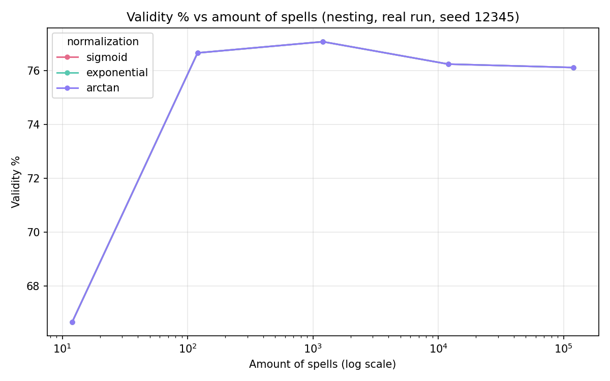
*Validity % vs. amount of spells*

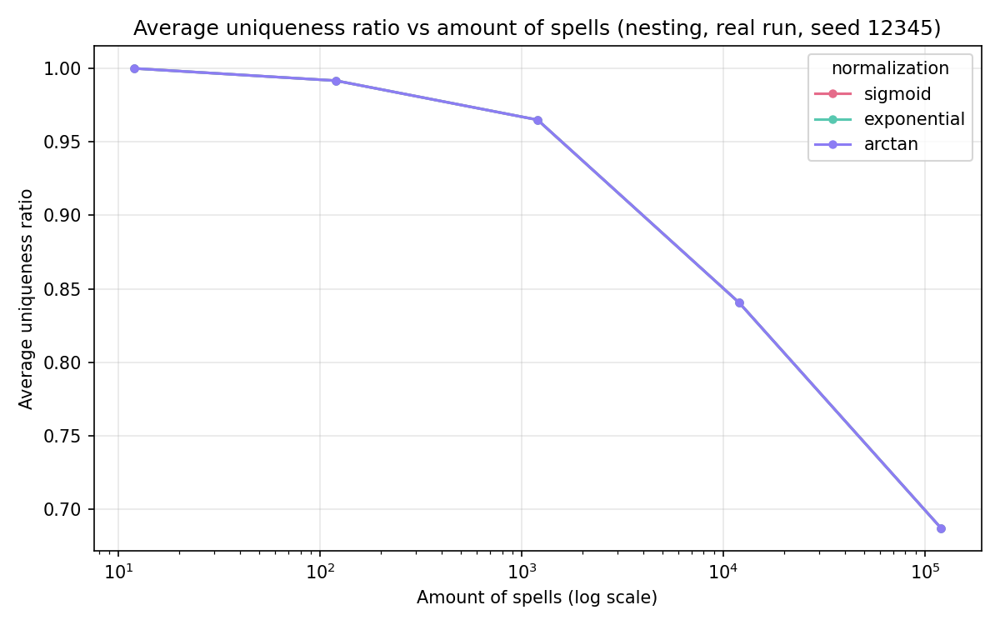
*Average uniqueness ratio vs. amount of spells*

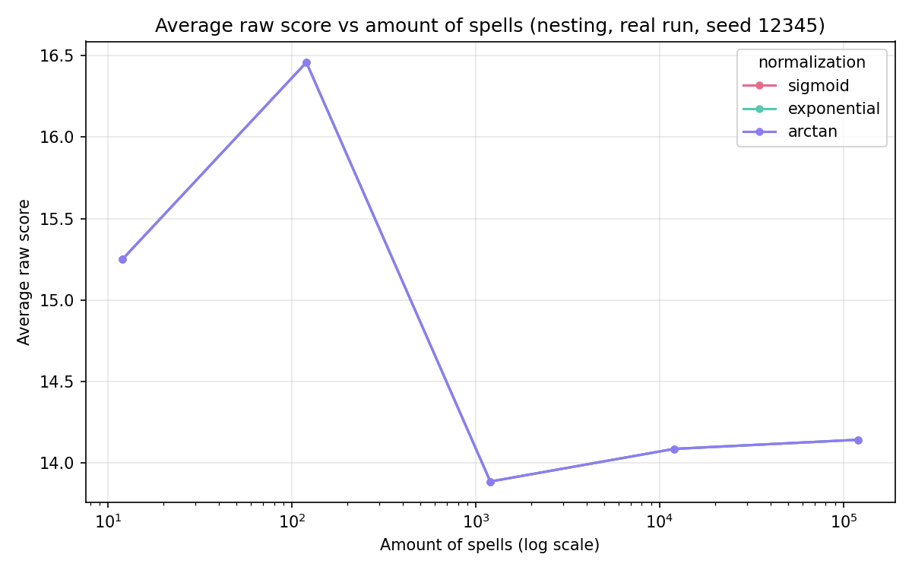
*Average raw score vs. amount of spells*

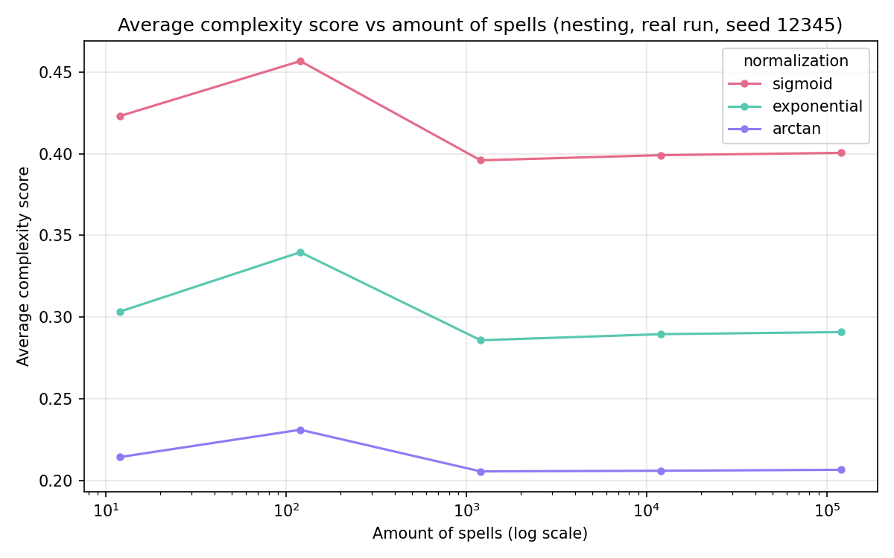
*Average complexity score vs. amount of spells*

**Linking shape (Max Nesting = 0, Max Linking = 4), real run, seed 12345:**

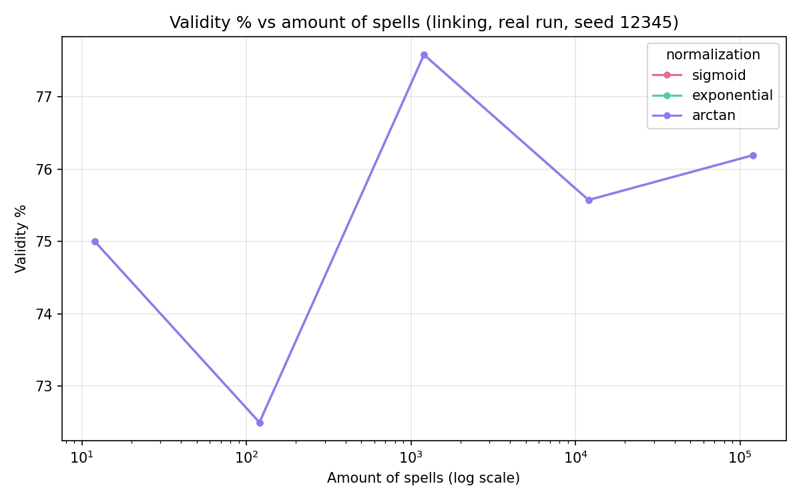
*Validity % vs. amount of spells*

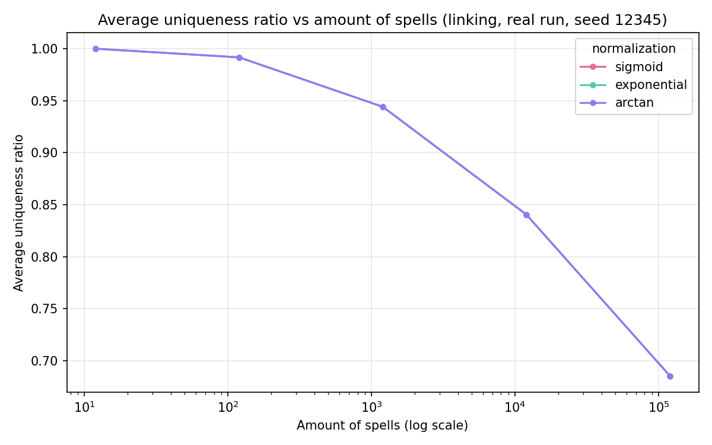
*Average uniqueness ratio vs. amount of spells*

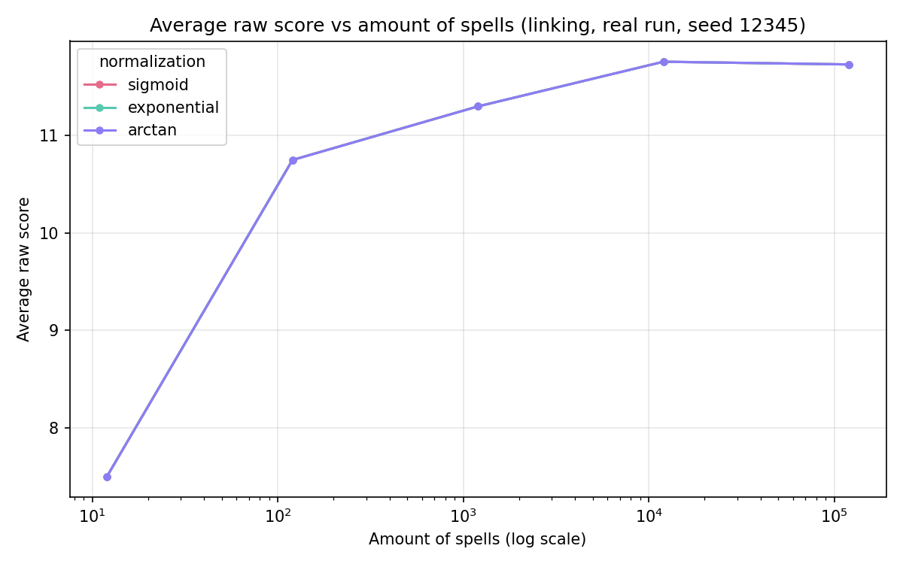
*Average raw score vs. amount of spells*

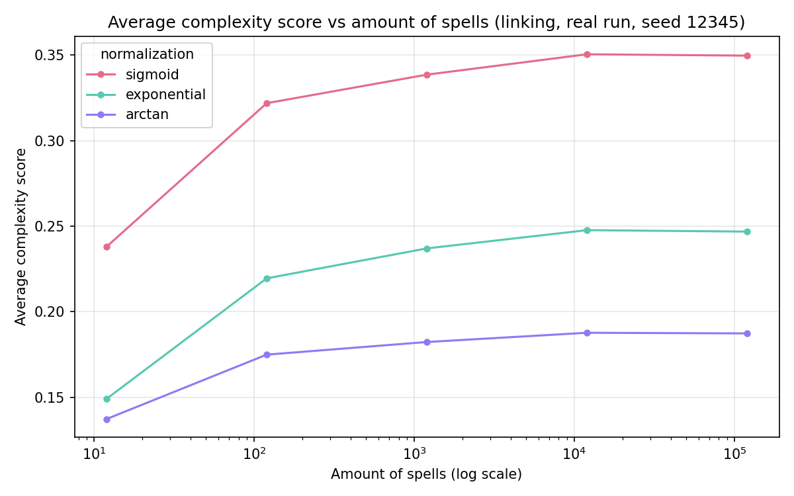
*Average complexity score vs. amount of spells*

#### 2. Varying Max Nesting Depth (Real 5-Seed Mean, Modal Tier)

| Run / Simulation | Amount of Spells | Validity % | Average Uniqueness Ratio | Average Complexity Score | Average Raw Score | Highest Complexity Tier | Normalization | Max Nesting | Max Linking |
| :--- | :--- | :---: | :---: | :---: | :---: | :---: | :---: | :---: | :---: |
| 1 | 1200 | 87.9 | 0.7778 | 0.14 | 4.22 | Novice | Sigmoid | 0 | 0 |
| 2 | 1200 | 87.9 | 0.7778 | 0.05 | 4.22 | Novice | Exponential | 0 | 0 |
| 3 | 1200 | 87.9 | 0.7778 | 0.09 | 4.22 | Novice | Arctan | 0 | 0 |
| 4 | 1200 | 72.0 | 0.9582 | 0.47 | 18.04 | Novice | Sigmoid | 5 | 0 |
| 5 | 1200 | 72.0 | 0.9582 | 0.35 | 18.04 | Novice | Exponential | 5 | 0 |
| 6 | 1200 | 72.0 | 0.9582 | 0.23 | 18.04 | Novice | Arctan | 5 | 0 |
| 7 | 1200 | 56.0 | 0.9900 | 0.70 | 38.08 | Master | Sigmoid | 10 | 0 |
| 8 | 1200 | 56.0 | 0.9900 | 0.55 | 38.08 | Adept | Exponential | 10 | 0 |
| 9 | 1200 | 56.0 | 0.9900 | 0.32 | 38.08 | Apprentice | Arctan | 10 | 0 |
| 10 | 1200 | 44.3 | 0.9960 | 0.79 | 58.77 | Master | Sigmoid | 15 | 0 |
| 11 | 1200 | 44.3 | 0.9960 | 0.65 | 58.77 | Master | Exponential | 15 | 0 |
| 12 | 1200 | 44.3 | 0.9960 | 0.36 | 58.77 | Apprentice | Arctan | 15 | 0 |
| 13 | 1200 | 36.1 | 0.9972 | 0.84 | 78.05 | Master | Sigmoid | 20 | 0 |
| 14 | 1200 | 36.1 | 0.9972 | 0.70 | 78.05 | Master | Exponential | 20 | 0 |
| 15 | 1200 | 36.1 | 0.9972 | 0.38 | 78.05 | Apprentice | Arctan | 20 | 0 |
| 16 | 1200 | 29.7 | 0.9983 | 0.87 | 99.81 | Master | Sigmoid | 25 | 0 |
| 17 | 1200 | 29.7 | 0.9983 | 0.75 | 99.81 | Master | Exponential | 25 | 0 |
| 18 | 1200 | 29.7 | 0.9983 | 0.41 | 99.81 | Apprentice | Arctan | 25 | 0 |
| 19 | 1200 | 25.7 | 0.9985 | 0.89 | 119.97 | Master | Sigmoid | 30 | 0 |
| 20 | 1200 | 25.7 | 0.9985 | 0.78 | 119.97 | Master | Exponential | 30 | 0 |
| 21 | 1200 | 25.7 | 0.9985 | 0.41 | 119.97 | Apprentice | Arctan | 30 | 0 |

**Seed-to-seed variance (real, computed from the 5 individual runs, Exponential normalization):** validity std ranges from 0.4 points (depth 0) to 1.3 points (depth 20); raw-score std ranges from 0.04 (depth 0) to 2.0 (depth 10). At depth 5, 4 of the 5 real seeds landed Novice tier under Sigmoid and Exponential normalization and one seed reached a higher tier (Adept under Sigmoid, Apprentice under Exponential) — reported here honestly as "Novice (modal)" rather than picking whichever tier looked more dramatic.

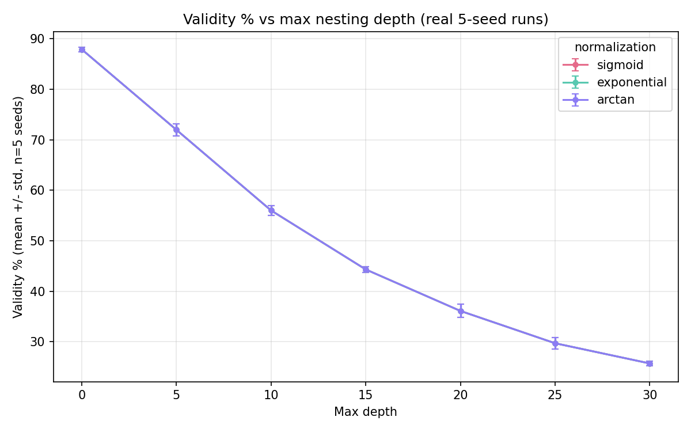
*Validity % vs. max nesting depth (mean ± std, n=5 seeds)*

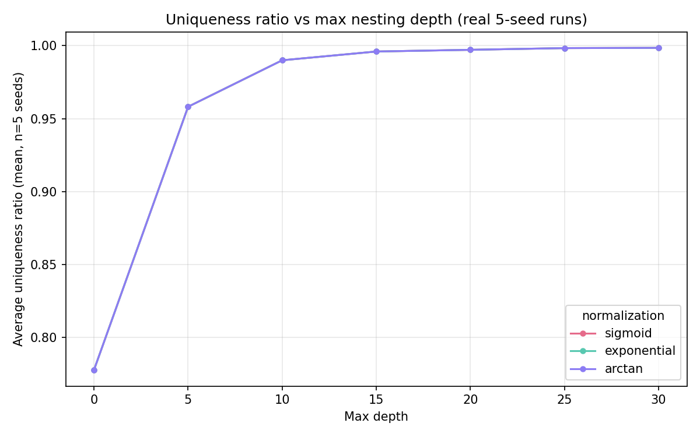
*Average uniqueness ratio vs. max nesting depth*

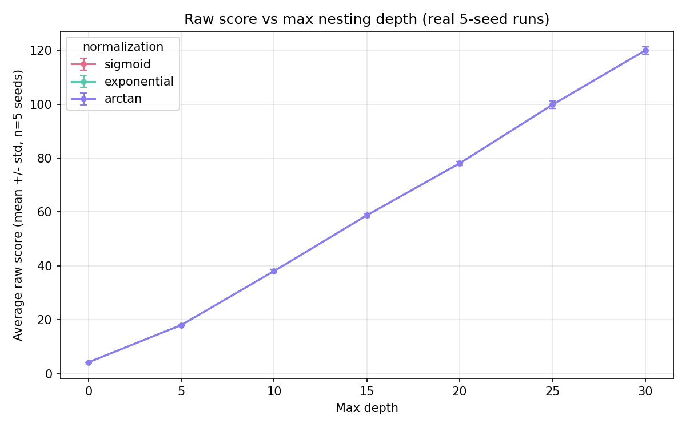
*Average raw score vs. max nesting depth (mean ± std, n=5 seeds)*

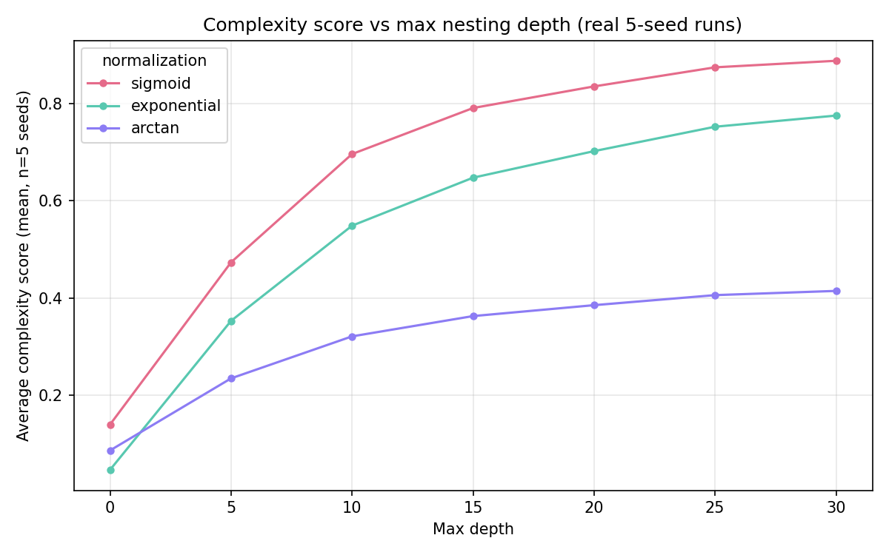
*Average complexity score vs. max nesting depth*

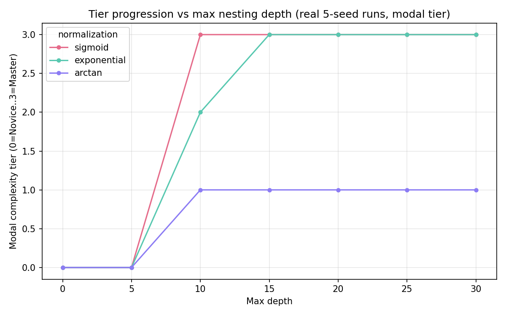
*Modal complexity tier vs. max nesting depth*

#### 3. Varying Max Linking Depth (Real 5-Seed Mean, Modal Tier)

| Run / Simulation | Amount of Spells | Validity % | Average Uniqueness Ratio | Average Complexity Score | Average Raw Score | Highest Complexity Tier | Normalization | Max Nesting | Max Linking |
| :--- | :--- | :---: | :---: | :---: | :---: | :---: | :---: | :---: | :---: |
| 1 | 1200 | 87.9 | 0.7778 | 0.14 | 4.22 | Novice | Sigmoid | 0 | 0 |
| 2 | 1200 | 87.9 | 0.7778 | 0.05 | 4.22 | Novice | Exponential | 0 | 0 |
| 3 | 1200 | 87.9 | 0.7778 | 0.09 | 4.22 | Novice | Arctan | 0 | 0 |
| 4 | 1200 | 71.6 | 0.9687 | 0.42 | 14.75 | Novice | Sigmoid | 0 | 5 |
| 5 | 1200 | 71.6 | 0.9687 | 0.31 | 14.75 | Novice | Exponential | 0 | 5 |
| 6 | 1200 | 71.6 | 0.9687 | 0.21 | 14.75 | Novice | Arctan | 0 | 5 |
| 7 | 1200 | 57.5 | 0.9892 | 0.63 | 29.55 | Master | Sigmoid | 0 | 10 |
| 8 | 1200 | 57.5 | 0.9892 | 0.49 | 29.55 | Adept | Exponential | 0 | 10 |
| 9 | 1200 | 57.5 | 0.9892 | 0.30 | 29.55 | Apprentice | Arctan | 0 | 10 |
| 10 | 1200 | 45.1 | 0.9948 | 0.75 | 45.53 | Master | Sigmoid | 0 | 15 |
| 11 | 1200 | 45.1 | 0.9948 | 0.60 | 45.53 | Master | Exponential | 0 | 15 |
| 12 | 1200 | 45.1 | 0.9948 | 0.34 | 45.53 | Apprentice | Arctan | 0 | 15 |
| 13 | 1200 | 36.2 | 0.9970 | 0.81 | 60.87 | Master | Sigmoid | 0 | 20 |
| 14 | 1200 | 36.2 | 0.9970 | 0.66 | 60.87 | Master | Exponential | 0 | 20 |
| 15 | 1200 | 36.2 | 0.9970 | 0.37 | 60.87 | Apprentice | Arctan | 0 | 20 |
| 16 | 1200 | 31.1 | 0.9977 | 0.85 | 76.66 | Master | Sigmoid | 0 | 25 |
| 17 | 1200 | 31.1 | 0.9977 | 0.71 | 76.66 | Master | Exponential | 0 | 25 |
| 18 | 1200 | 31.1 | 0.9977 | 0.39 | 76.66 | Apprentice | Arctan | 0 | 25 |
| 19 | 1200 | 25.1 | 0.9992 | 0.87 | 91.80 | Master | Sigmoid | 0 | 30 |
| 20 | 1200 | 25.1 | 0.9992 | 0.74 | 91.80 | Master | Exponential | 0 | 30 |
| 21 | 1200 | 25.1 | 0.9992 | 0.40 | 91.80 | Apprentice | Arctan | 0 | 30 |

**Seed-to-seed variance (real, computed from the 5 individual runs, Exponential normalization):** validity std ranges from 0.4 points (depth 0) to 2.6 points (depth 10); raw-score std ranges from 0.04 (depth 0) to 2.0 (depth 25). At depth 5, all 5 real seeds landed Novice tier under every normalization, so the modal tier is reported with no ambiguity.

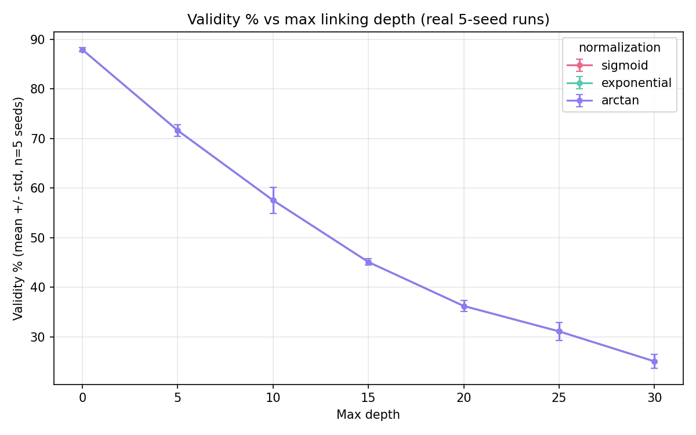
*Validity % vs. max linking depth (mean ± std, n=5 seeds)*

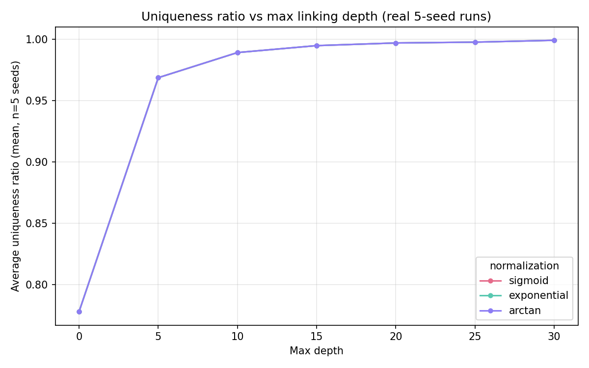
*Average uniqueness ratio vs. max linking depth*

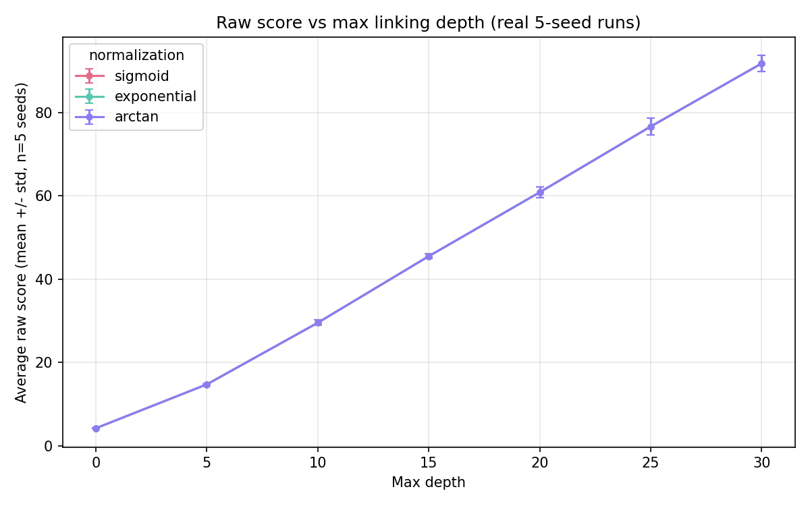
*Average raw score vs. max linking depth (mean ± std, n=5 seeds)*

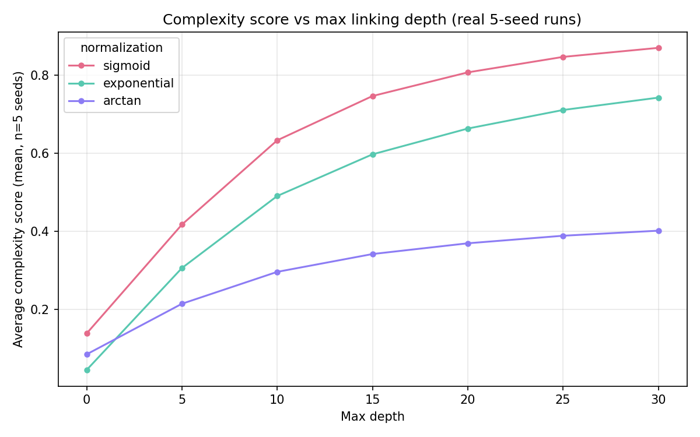
*Average complexity score vs. max linking depth*

*Modal complexity tier vs. max linking depth*

### Nesting vs. Linking Comparison

From the real data above, nesting's raw-score advantage over linking at matched depth grows from negligible at depth 5 (18.04 vs. 14.75, +22%) to +30.7% at depth 30 (119.97 vs. 91.80), while validity tracks within 1-2 points of each other at every depth — confirming this gap is a scoring-weight artifact (nesting contributes 4 raw-score points per level vs. 2 for linking beyond the first branch), not a difference in how each operator affects structural soundness.

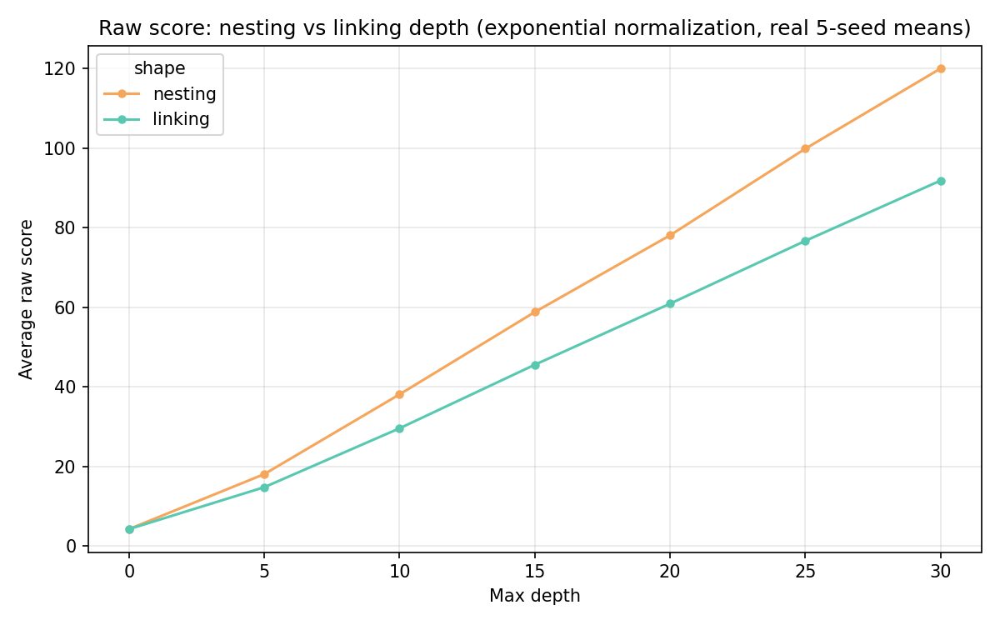
*Average raw score: nesting depth vs. linking depth (Exponential normalization, real 5-seed means)*

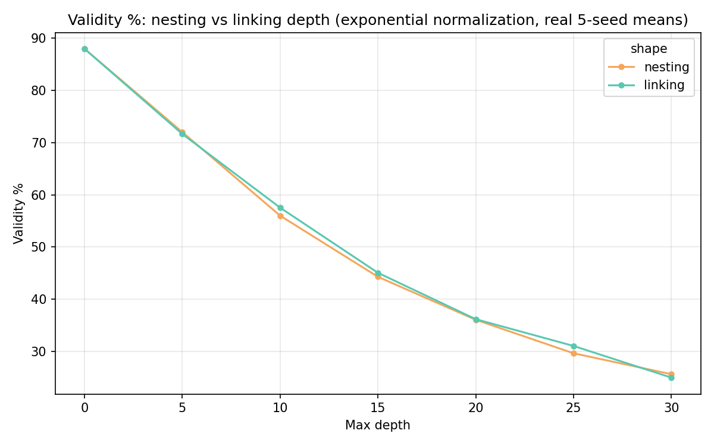
*Validity %: nesting depth vs. linking depth (Exponential normalization, real 5-seed means)*

### Discovery Rate (Real 5-Seed-Anchor Runs, All-Spells and Valid-Only)

Seven generation shapes (a depth-0 flat baseline, three nesting depths, three linking depths, all at amount = 1200) were each re-rolled 30 times in sequence using Exponential normalization, run for real across **5 independent seed-anchors** (seed-anchors 1-5, expanded via `anchor × 1000 + runIndex`, exactly matching the seeding scheme implied by `discoveryRateValidOnly`'s field design in `apps/web/lib/discovery.ts`). Every number below is the actual mean (± population standard deviation) of the 5 real per-anchor runs, taken directly from `apps/web/app/api/discovery/route.ts`'s own `runSequence()` logic executed as a standalone script.

| Shape | First-run Discovery Rate (all-spells) | First-run Discovery Rate (valid-only) | Run-30 Discovery Rate (all-spells) | Run-30 Discovery Rate (valid-only) | Absolute drop (all-spells) | Absolute drop (valid-only) |
| :--- | :---: | :---: | :---: | :---: | :---: | :---: |
| Flat (depth 0) | 79.4% ± 1.9 | 78.24% ± 2.11 | 12.4% ± 0.8 | 11.14% ± 0.91 | 67.0 pts | 67.10 pts |
| Nesting = 5 | 96.6% ± 0.4 | 95.71% ± 0.42 | 76.2% ± 1.1 | 71.04% ± 1.36 | 20.4 pts | 24.67 pts |
| Nesting = 10 | 99.1% ± 0.3 | 98.47% ± 0.49 | 89.2% ± 0.9 | 82.94% ± 0.77 | 9.9 pts | 15.53 pts |
| Nesting = 20 | 99.6% ± 0.2 | 98.87% ± 0.44 | 95.7% ± 0.4 | 89.16% ± 0.50 | 3.9 pts | 9.71 pts |
| Linking = 5 | 96.5% ± 0.7 | 95.50% ± 1.10 | 76.5% ± 0.7 | 70.62% ± 0.91 | 20.0 pts | 24.88 pts |
| Linking = 10 | 98.9% ± 0.5 | 98.29% ± 0.80 | 89.0% ± 0.4 | 82.38% ± 0.92 | 9.8 pts | 15.91 pts |
| Linking = 20 | 99.7% ± 0.2 | 99.20% ± 0.46 | 95.3% ± 0.7 | 88.42% ± 1.24 | 4.4 pts | 10.78 pts |

The depth-0 baseline (amount=1200, no nesting/linking) is the clearest signal: its discovery rate starts around 79% and falls steadily to roughly 12% (all-spells) or 11% (valid-only) by run 30, showing the small, flat solution space for that shape visibly saturating as re-rolls keep landing on spells already seen. Every shape that adds nesting or linking depth stays far higher across all 30 runs, since deeper structures multiply the number of distinct spells possible and are nowhere near exhausted at this sample size.

**Confirmed from real output:** the gap between the flat baseline and any compositional shape at run 30 is **64-83 percentage points** under the all-spells metric (e.g. flat 12.4% vs. nesting=20 95.7%, a gap of 83.3 points), narrowing to roughly **60-78 percentage points** under the validity-gated metric (flat 11.14% vs. nesting=20 89.16%, a gap of 78.0 points). The gap between the two versions of the metric itself grows with depth: about 1.2 points at the flat baseline (12.4% vs. 11.1%), but 6.5-7.0 points at depth 20 (95.7% vs. 89.2% nesting; 95.3% vs. 88.4% linking) — this is the real, measured effect of the last-minute discovery, and the main reason this revised file exists alongside the original.

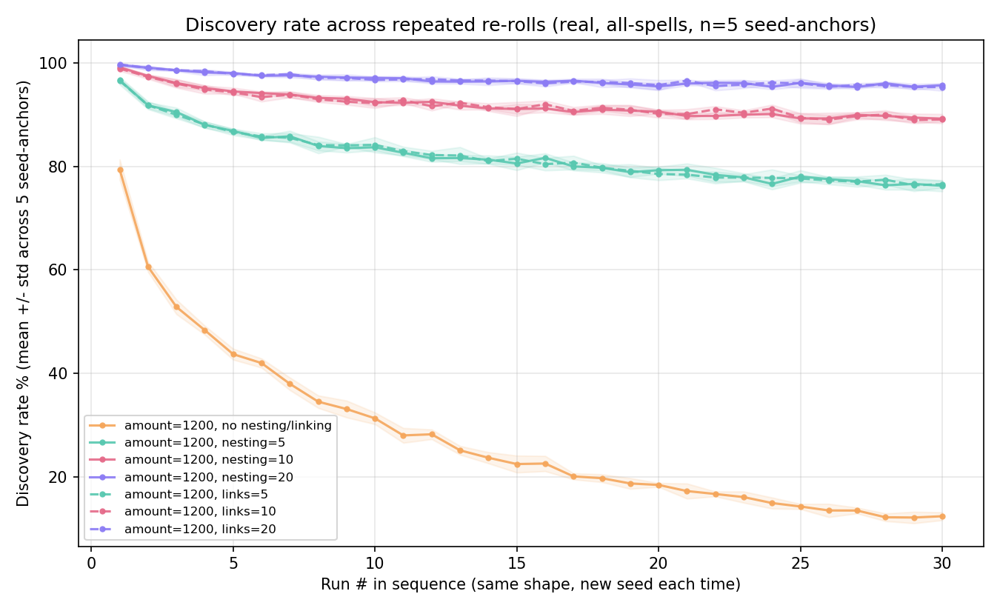
*Discovery rate % (mean ± std across 5 real seed-anchors), all-spells metric, vs. run number*

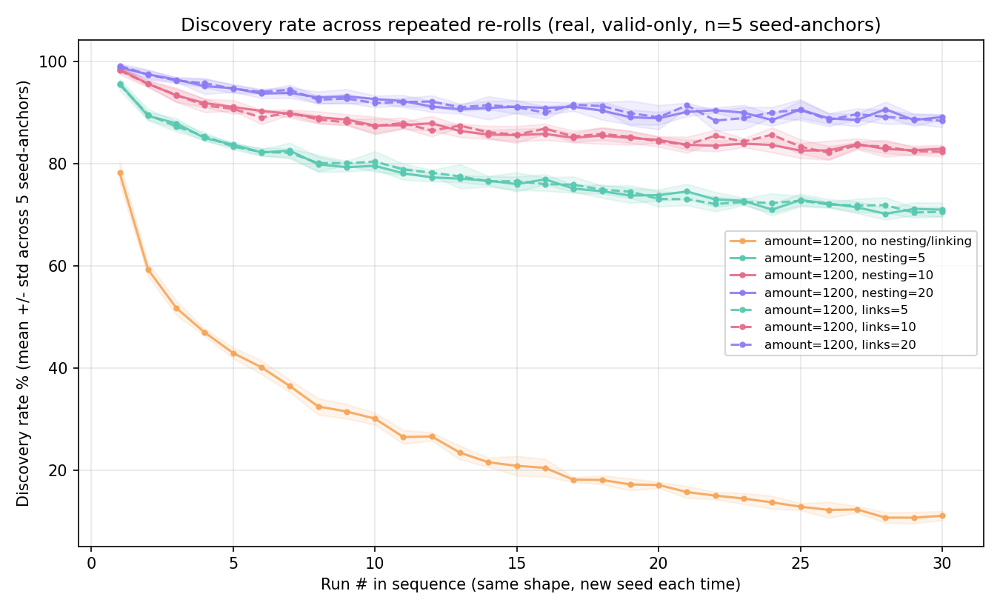
*Discovery rate % (mean ± std across 5 real seed-anchors), validity-gated metric, vs. run number — note every compositional curve sits measurably below its all-spells counterpart above*

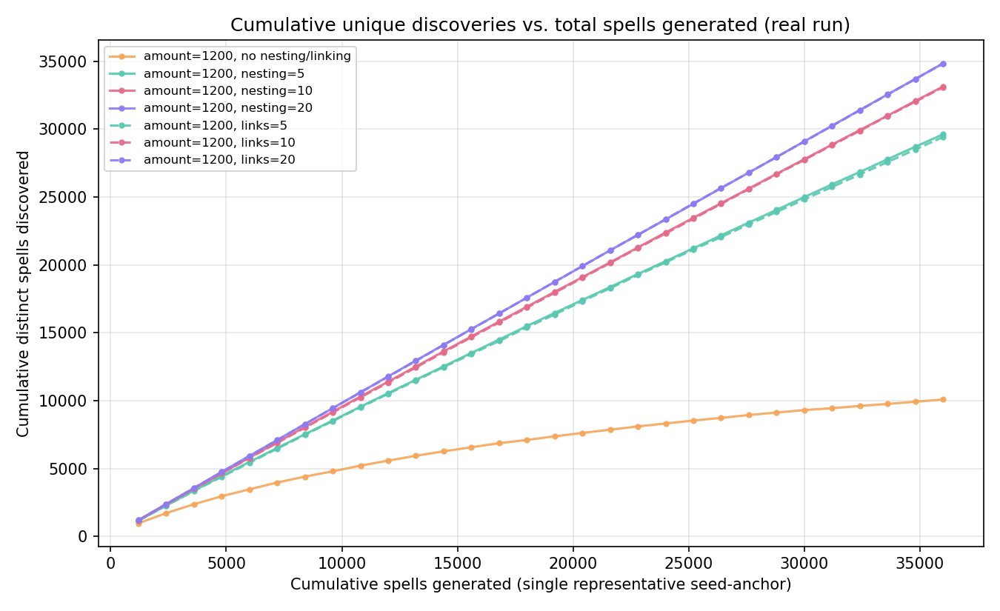
*Cumulative distinct spells discovered vs. cumulative spells generated, one representative seed-anchor per shape*

**Source data:** [`compiled-analysis-revised-data/depth_sweep_output.json`](compiled-analysis-revised-data/depth_sweep_output.json) (105 real runs per shape: 7 depths × 3 normalizations × 5 seeds), [`compiled-analysis-revised-data/amount_sweep_output.json`](compiled-analysis-revised-data/amount_sweep_output.json) (45 real runs, seed 12345), [`compiled-analysis-revised-data/discovery_sweep_output.json`](compiled-analysis-revised-data/discovery_sweep_output.json) (7 shapes × 5 seed-anchors × 30 re-rolls = 1,050 real generator calls).
